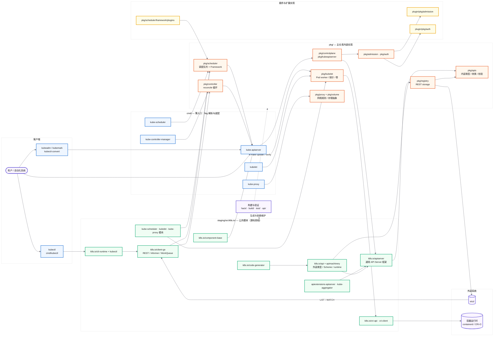

# Kubernetes 仓库架构图

> 按本机仓库 `release-1.37-zh` 分支的实际目录结构核对，2026-11-25。
> 这张图是**源码仓库架构**：进入每个组件的命令、实现和公共模块边界；不是 Kubernetes 集群的网络拓扑图。
> 节点标签是目录或组件名，不是进程实例的部署位置。

## 图例

| 颜色 | 含义 |
| --- | --- |
| 蓝 | 命令入口（`cmd/`） |
| 橙 | 主仓库内部实现（`pkg/`） |
| 绿 | 公共可发布模块（`staging/src/k8s.io/`） |
| 黄 | 插件与扩展实现（`plugin/`、`pkg/scheduler/framework/plugins/`） |
| 紫 | 外部入口与工具（用户、etcd、容器运行时、构建工具） |

节点边框颜色即分类，所有节点都有文字标签；虚线只表示构建/测试工具不参与运行时请求链。

## 架构图（Mermaid）

## 怎么读这张图

1. **入口层很薄。** `cmd/<组件>/main.go` 只负责启动和装配；`NewXxxCommand()` 之后的实现在 `pkg/` 或 `staging/`。
2. **控制面围绕 API Server。** Controller Manager 与 Scheduler 主要通过 LIST/WATCH 获得变化、通过 REST 写回资源，不互相直接调用函数。
3. **节点侧走 CRI。** Kubelet 从 API Server 读 Pod 期望状态，通过 CRI 驱动容器运行时；kube-proxy 负责 Service 转发规则。
4. **staging 是 `k8s.io/*` 的源码真相。** 修改客户端或 apiserver 公共框架，要改 `staging/src/k8s.io/`，不是 `vendor/`；staging 不得反向 import `k8s.io/kubernetes`。
5. **plugin/ 不等于所有插件。** 调度插件在 `pkg/scheduler/framework/plugins/`；client-go 认证插件在 `staging/src/k8s.io/client-go/plugin/pkg/client/auth/`。

## 一句话主线

`kubectl → client-go REST → kube-apiserver（apiserver 框架 + registry + etcd）→ informer/watch → scheduler/controller → API Server → kubelet → CRI → 容器运行时`

细节与函数级入口见 `09-repository-directory-map.md` §4、`01-code-map.md` 与 `07-mental-model.md`。
